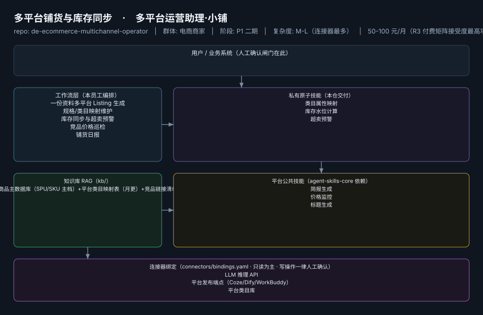

# 多平台铺货与库存同步

> 多平台运营助理·小铺 ｜ 一人店的"轻量 ERP"，只做真正用的 20% 功能
>
> **多平台运营助理·小铺**　·　电商商家　·　阶段 P1 二期　·　
> 复杂度 M-L（连接器最多）　·　50-100 元/月（R3 付费矩阵接受度最高项）　·　定义卡 6.4-④



**一句话**：同时运营 2-4 个平台、SKU 20-500 的卖家

---

## 这个数字员工解决什么问题

多平台运营助理·小铺 ｜ 一人店的"轻量 ERP"，只做真正用的 20% 功能

| 项 | 内容 |
|---|---|
| 服务对象 | 同时运营 2-4 个平台、SKU 20-500 的卖家 |
| 可量化目标 | 单款铺货耗时 90 分钟→15 分钟；超卖事故 = 0；价格异动发现 ≤1 小时 |
| 投入产出 | 替代 ERP ¥3000-10000/年（聚水潭 9.3 万客户 vs 2500 万卖家，据R3调研）+ 月省 26h≈¥780 |
| 需求依据 | D13、D12、D02 |
| 分发渠道 | GitHub、Dify Marketplace（DAG 编排天然契合）、淘宝（"铺货模板+映射表"SKU） |

## 30 秒上手

```bash
git clone <本仓库地址> && cd de-ecommerce-multichannel-operator
pip install pyyaml
python3 tests/run.py            # 先跑一遍自检，确认环境与契约都对得上
```

试用（把 `<输入>` 换成本人真实材料）：

```text
请以「多平台铺货与库存同步」的身份，帮我跑「一份资料多平台 Listing 生成」。
材料如下：<输入>
要求：只使用材料里出现过的数字，缺的写 <待填>；对外文案停在待确认状态。
```

详细接入见 [`docs/01-安装与接入.md`](docs/01-安装与接入.md)。

## 仓库结构

```text
de-ecommerce-multichannel-operator/
├── employee.yaml          # 机器契约（能力清单 + 依赖锁）
├── dependencies.yaml      # 对 core 的外部依赖（含版本）
├── persona/               # 运行提示词 / 边界 / KPI
├── skills/                # 私有原子技能（3 个）
├── spec-bindings/         # 有意不公共化能力的本地绑定声明（0 个）
├── workflows/             # 本员工工作流（5 条）
├── kb/                    # 知识库 RAG 契约
├── connectors/            # 连接器绑定（只读为主，写操作人工确认）
├── docs/                  # 六类发布文档
└── tests/                 # 自动化多场景测试
```

## 私有原子技能（3）

| 技能 | slug | 复杂度 | 阶段 | 成熟度 |
|---|---|---|---|---|
| `类目属性映射` | `category-attr-map` | M | P1 | 已实现 |
| `库存水位计算` | `inventory-waterline-calc` | M | P1 | 契约完备 |
| `超卖预警` | `oversell-alert` | S | P1 | 契约完备 |

## 平台公共技能依赖（3）

| 技能 | slug | 全平台复用员工数 |
|---|---|---|
| `简报生成` | `brief-generator` | 10 |
| `价格监控` | `price-monitor` | 2 |
| `标题生成` | `title-generator` | 4 |

> 这些技能来自 `agent-skills-core@1.0.0`，本仓库**只引用不复制**。

## Spec 绑定层（0）

（无）

> 这一族能力**有意不公共化**（与外部平台接口强绑定）。本仓不存正文，
> 只留本地绑定声明与连接器配置。

## 工作流（5）

| 工作流 | slug | 触发 | 阶段 | 调用技能数 |
|---|---|---|---|---|
| `一份资料多平台 Listing 生成` | `wf-ecom-ops-listing-gen` | 人工 | P1 | 2 |
| `规格/类目映射维护` | `wf-ecom-ops-spec-map` | 人工（每月） | P1 | 1 |
| `库存同步与超卖预警` | `wf-ecom-ops-inventory-sync` | 定时（每 15 分钟） | P1 | 2 |
| `竞品价格巡检` | `wf-ecom-ops-price-patrol` | 定时（每日） | P1 | 1 |
| `铺货日报` | `wf-ecom-ops-daily-report` | 定时（每日 21:00） | P2 | 1 |

## 知识库与连接器

- 知识库语料：['商品主数据库（SPU/SKU 主档）+平台类目映射表（月更）+竞品链接清单']
- 连接器：LLM 推理 API、平台发布端点（Coze/Dify/WorkBuddy）、平台类目库、电商平台商品/订单

## 质量与验收

| 项 | 值 |
|---|---|
| 技能文件数 | 127 |
| 多场景用例数 | 230 |
| 用例通过 | 230 |
| 验收结论 | ✅ 通过 |

完整报告：[`docs/05-验收与测试.md`](docs/05-验收与测试.md)

## 许可

专有许可，详见 [`LICENSE`](LICENSE)。
