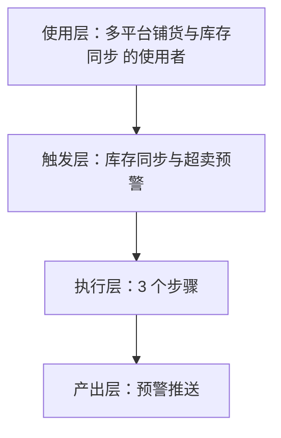
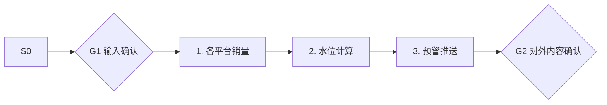

# 库存同步与超卖预警 · 架构与流程图

## 本工作流的四层结构

| 层 | 内容 |
|---|---|
| 使用层 | 同时运营 2-4 个平台、SKU 20-500 的卖家；员工定位：多平台运营助理·小铺 ｜ 一人店的"轻量 ERP"，只做真正用的 20% 功能 |
| 触发层 | 关键词 / 显式点名「库存同步与超卖预警」；触发方式：定时（每 15 分钟） |
| 执行层 | 各平台销量 → 水位计算 → 预警推送 |
| 产出层 | 预警推送 |

## 执行流程

## 步骤职责表

| # | 步骤 | 承担者 | 为什么 |
|---|---|---|---|
| 1 | 各平台销量 | 模型 | 需要读懂语境，不可用固定规则替代 |
| 2 | 水位计算 | 模型 | 需要读懂语境，不可用固定规则替代 |
| 3 | 预警推送 | 模型 | 需要读懂语境，不可用固定规则替代 |

⚠️ 尚未补齐：图中的步骤来自注册表口径，未逐条实跑校验；实跑后请同步修订本页（`发布标准.md` 第六项：通读一遍，不得出现重复填充句）。
